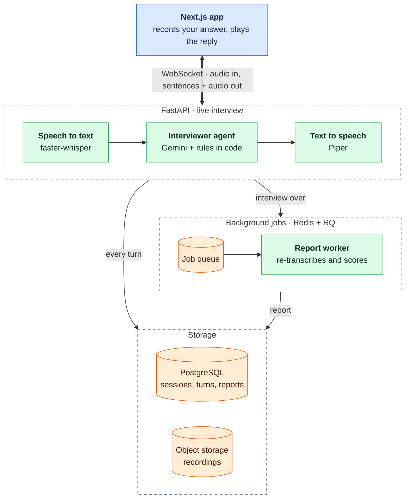
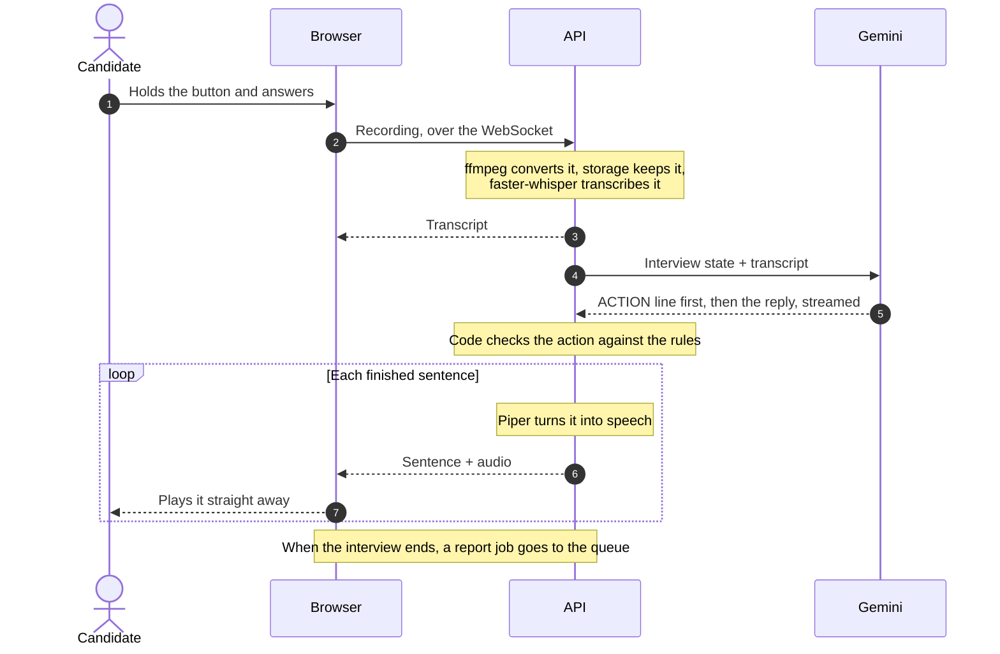

# Offerward

Spoken mock interviews with an AI interviewer. You answer out loud, it listens and asks follow-up questions based on what you actually said, and when you're done you get a scored feedback report.

**[Try it at offerward.vercel.app](https://offerward.vercel.app)**. It works in the browser on a laptop or a phone.

<!-- demo GIF: docs/demo.gif -->

## What you can practise

| Interview | Topics |
|---|---|
| Junior Backend Developer | REST APIs, databases, Git, debugging, teamwork |
| Junior Frontend Developer | HTML/CSS, JavaScript, React, browser debugging, teamwork |
| Junior AI Engineer | ML basics, LLMs and prompting, RAG and embeddings, evaluating AI systems, teamwork |
| Junior Data Analyst | SQL, data cleaning, statistics, visualization, communicating findings |
| Behavioural (HR) | tell me about yourself, teamwork and conflict, a mistake you made, working under pressure, why this role |

An interview takes 5 to 10 minutes: 5 topics, with up to 2 follow-ups on each. About a minute after it ends, the report is ready. It scores you from 1 to 5 on technical accuracy, clarity, structure and depth, quotes your own words as examples, and tells you what to work on.

## How it works



The interview runs turn by turn: you hold a button while you answer, and let go when you're done. The interviewer starts speaking as soon as its first sentence is ready, rather than waiting for the whole reply:



### The interviewer: the model suggests, the code decides

An interview has rules. Topics come in order, there are at most 2 follow-ups per topic, and the interview only ends after the last topic. A language model will follow rules like that most of the time, which isn't good enough. So Offerward doesn't leave them to the prompt.

The interview state is plain data: the topics, the current one, and how many follow-ups it has had. It's saved after every turn, so a refresh or a dropped connection doesn't lose your place. From that state, the code works out which actions are allowed right now. The prompt offers Gemini only those, and the code checks its choice against the same list. If Gemini picks something that isn't allowed, such as a third follow-up or ending early, the code moves the interview forward instead.

Gemini writes its decision on the first line of the reply, before the words it will say. That's what makes streaming safe: the check has already happened before the first sentence is spoken.

A few things never reach the model at all. A two-word answer gets "Could you say a bit more about that?". A question pasted back gets "Please answer the question in your own words". If Gemini fails, the code retries once, then moves on by itself, so the interview can't get stuck. Whatever the candidate says is treated as data, not instructions, so "ignore your previous instructions" doesn't change anything.

Reports work the same way. Gemini judges each criterion, the overall score is calculated in code, and every quote is checked against the transcript before it's shown.

## Response time

How long it takes from letting go of the button to hearing the first word of the reply. Measured in the browser, on a local development setup, over 10–11 spoken answers each time:

| | Median | p90 |
|---|---|---|
| Waiting for the full reply, then speaking | 6.9 s | 10.4 s |
| **Streaming the reply, sentence by sentence** | **5.1 s** | **9.4 s** |

In the streaming version, Whisper takes about 1.4 s, Gemini 3.7 s, Piper 0.26 s, and the upload and playback about 0.1 s. Gemini is most of the wait, and it varies a lot from one reply to the next. The target is 2–3 s, and getting there means a faster model or a smaller prompt.

The biggest gains weren't where we expected. Switching to Gemini's streaming endpoint brought the first text about 3 seconds sooner. Another 2 seconds were lost on some turns because `localhost` tried IPv6 before the storage server's IPv4 address.

## How reliable is the feedback?

The report comes from an AI judge, so it's only useful if its scores are close to what a careful human would give. To check, we built a test set of 20 interview answers across backend, frontend, AI and behavioural questions. It mixes strong, average and weak answers with deliberately tricky ones: confident but wrong, correct but rambling, very short, broken English, and answers mangled by speech-to-text. Every answer was scored by hand **before** the judge saw it, which gives 80 human scores. Another 8 answers (32 scores) were held back and used only once, at the end.

**Prompt versions,** on the 20 answers, averaged over 3 runs:

| Version | What changed | Within 1 point | Exact match | Mean difference | Same score in all 3 runs |
|---|---|---|---|---|---|
| **v1** | a full rubric for every level, examples, reasoning before the score | 82.5% | 41.7% | 0.76 | 68.8% |
| v2 | v1 + judge each criterion on its own | 83.3% | 43.9% | 0.73 | 64.5% |
| v3 | v2 + 3 scored example answers | 84.2% | 39.6% | 0.77 | 70.0% |
| *baseline* | *always answer 3* | *65.0%* | *15.0%* | *1.20* | — |

**On the 8 held-back answers:**

| Version | Within 1 point | Exact match | Mean difference | Same score in all 3 runs |
|---|---|---|---|---|
| **v1** | 93.8% | 43.8% | 0.62 | 75.0% |
| v3 | 93.8% | 39.6% | 0.67 | 71.9% |
| *baseline (always 3)* | *81.2%* | *40.6%* | *0.78* | — |

What this means in practice:

- **Treat a score as a guide, not a verdict.** The judge is within a point of the human score about 4 times in 5, clearly better than always guessing 3. It hits the exact score less than half the time.
- **v1 is in production.** The later prompts didn't really improve on it. The differences were smaller than the noise between runs of the same prompt, and v3 did slightly worse on the held-back answers. So the simplest version stayed.
- **The weak spots:** answers that are correct but rambling (within a point only 25% of the time), and very short correct answers, which the judge scores higher than a human would. Depth is the hardest criterion to match exactly.
- **There's some halo effect.** The judge gives an answer's 4 criteria more similar scores than a human does. The average gap between an answer's best and worst criterion is 1.00, against 1.35 for the human scores.

The interviewer was checked too. Real interviews were reviewed against a checklist, and the same moments were replayed 4 times each, before and after a prompt fix. Corrections after a wrong answer went from 2 in 4 to 0 in 4. Moving on after a good answer went from 11 in 12 to 12 in 12. Follow-ups still sometimes hint at the answer, but now as a question rather than an explanation.

The evaluation scripts are in `backend/scripts/` (`evaluate.py`, `consistency.py`, `version_table.py`). The test answers themselves aren't published.

## Tech stack

| | Choice | Why |
|---|---|---|
| Frontend | Next.js, TypeScript, Tailwind | Records the microphone, plays the reply in order, renders reports |
| Backend | FastAPI | WebSockets built in, async, and Python like the rest of the AI code |
| LLM | Gemini (flash-lite) | Fast and cheap enough to run on every turn; it's both the interviewer and the judge |
| Speech to text | faster-whisper | Runs on the server's CPU with no per-minute cost. A small model live, a larger one for reports |
| Text to speech | Piper | Runs locally and speaks a sentence in about a quarter of a second |
| Database | PostgreSQL, SQLAlchemy 2.0, Alembic | Users, sessions, turns and reports are relational. Every schema change is a migration |
| Jobs | Redis + RQ | Scoring takes up to a minute, so it runs after the interview. Redis also backs the rate limits |
| Recordings | S3-compatible storage | SeaweedFS locally, Cloudflare R2 in production |
| Hosting | Vercel, Railway | HTTPS everywhere, which browsers require for microphone access |
| Monitoring | Sentry, JSON logs | Every log line of an interview carries its `session_id`, in the API and the worker |
| CI | GitHub Actions | ruff, eslint, tsc and 500+ backend tests against a real Postgres on every push |

## Security and cost controls

- Passwords are hashed with Argon2. Logins get a short-lived access token and a refresh token.
- Every request checks that the session belongs to you. The recordings live in private storage, and the API only sends a recording to its owner.
- Each account can start 5 interviews a day. The count is in Postgres and is checked and updated in a single statement, so two requests at the same moment can't both slip through.
- Rate limits cover login (per email and per address), sign-up and starting interviews, with a `429` and `Retry-After` when you hit them.
- Migrations run before each deploy. If they fail, the previous version keeps running.
- Sentry never receives IP addresses, request bodies or local variables, which could contain answers or tokens.

## Running it locally

You'll need Docker, [uv](https://docs.astral.sh/uv/), Node.js 20+, ffmpeg and a [Gemini API key](https://aistudio.google.com/apikey).

```bash
git clone https://github.com/korinando/AICoaching.git && cd AICoaching
cp .env.example .env && cp backend/.env.example backend/.env   # add your Gemini key and a JWT_SECRET of 32+ characters
docker compose up -d db storage redis
cd backend && uv sync && uv run python -m scripts.prepare_database && uv run uvicorn app.main:app
cd frontend && npm install && npm run dev                       # in a second terminal, from the repo root
```

Then open http://localhost:3000. On the first start, the API downloads the Whisper model and the Piper voice, about 200 MB. Keep the storage keys the same in both `.env` files.

To get reports, start the worker too, with `docker compose up -d worker`. It uses Whisper's `turbo` model (about 1.6 GB), which needs to be in `backend/whisper_models` first.

To run the tests: `cd backend && uv run pytest`, with the Docker services running.

## Project layout

```
backend/
  app/agent/      the interviewer: state, prompts, rules
  app/scoring/    the report judge and rubric
  app/speech/     ffmpeg, Whisper, Piper, sentence splitting, storage
  app/api/        REST routes and the interview WebSocket
  app/workers/    background report jobs
  alembic/        database migrations
  scripts/        evaluation and maintenance scripts
frontend/
  app/            pages: dashboard, interview, report, history, mic test
  components/     shared UI
  lib/            API client, WebSocket, recorder, audio queue
```

## Roadmap

- Faster replies, by trying a faster model, trimming the prompt, and streaming the opening question too
- Hands-free answers that detect when you've stopped talking and let you interrupt
- More roles and levels, and interviews generated from a job description
- Tracking your progress across interviews
